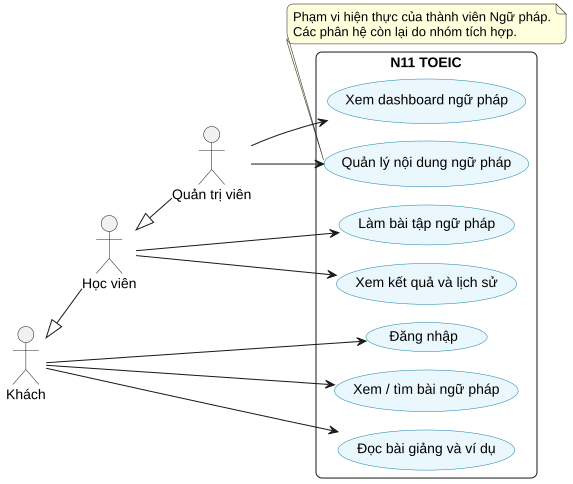
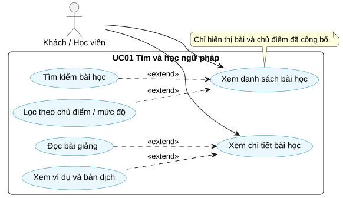
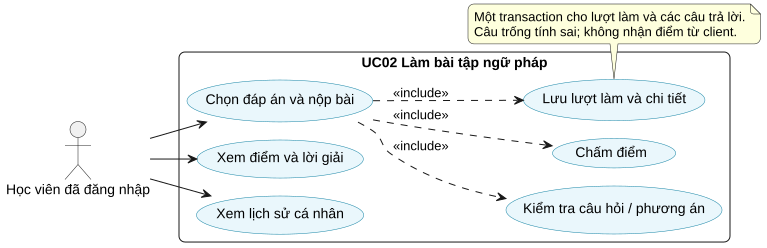
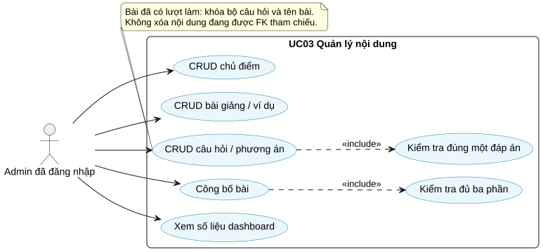
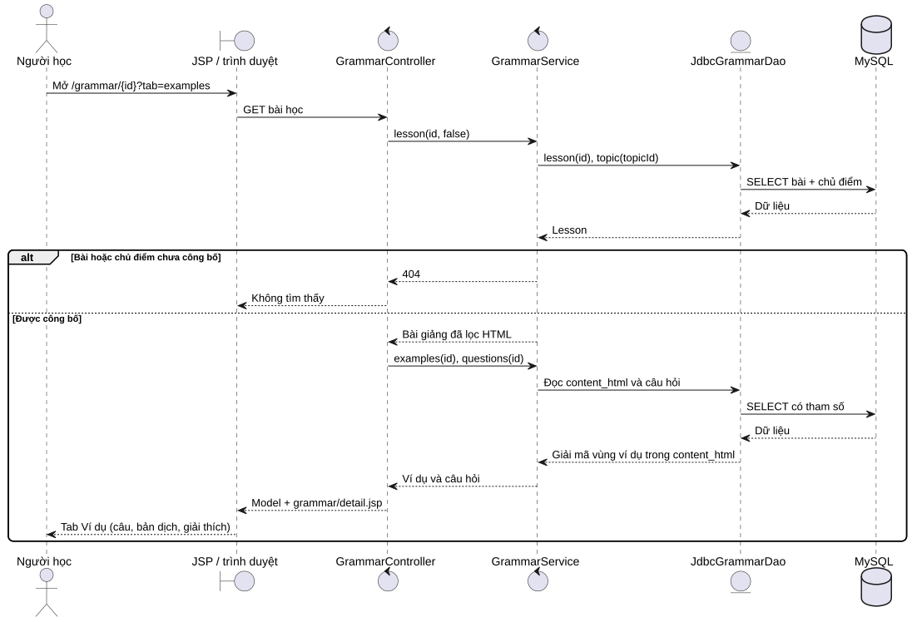
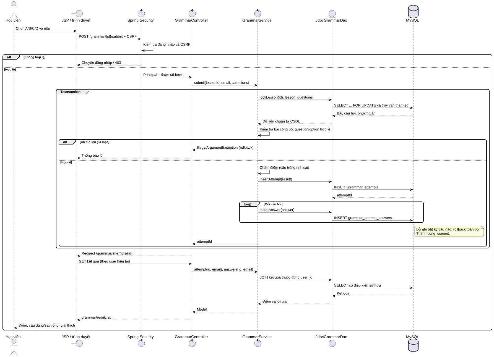

# Thiết kế và hiện thực chức năng Ngữ pháp

## Phạm vi và đối chiếu thường xuyên 1

Chức năng Ngữ pháp cho phép người học tìm bài, đọc lý thuyết và ví dụ, chọn đáp án, nộp bài và xem lịch sử cá nhân. Admin quản lý nội dung và xem số liệu. Công nghệ: Spring Boot, MySQL, JSP/JSTL, Bootstrap 5, DAO/JDBC. Schema sử dụng đúng bản `CSDL.docx` mới của nhóm.

| Yêu cầu TX1 | Hiện thực trong module |
| --- | --- |
| 1 use case tổng quát | `uml/01-usecase-overview.puml` |
| 3 use case chi tiết | `uml/02`, `03`, `04` và đặc tả dưới đây |
| 2 sequence diagram | `uml/05-sequence-read.puml`, `06-sequence-submit.puml` |
| Bootstrap responsive, trang chủ, menu | Trang chủ của nhóm, header dùng chung, các trang ngữ pháp |
| Form có validation | Bài học, chủ điểm, ví dụ, câu hỏi; validation server là bắt buộc |
| Dashboard quản trị | `/admin/grammar`, số liệu từ truy vấn MySQL |
| CSDL và SQL export | Thư mục `database/`, 31 bảng theo nhóm, seed riêng |
| DAO/JDBC CRUD | `GrammarDao`, `JdbcGrammarDao` dùng `JdbcTemplate` |
| Service interface | `GrammarService`, `DefaultGrammarService` |
| Ít nhất 2 test case | Bộ kiểm thử tự động và kịch bản tại `TESTING.md` |

Phần báo cáo Word và slide toàn nhóm cần ghép tài liệu này vào mẫu BTL của lớp. File PDF yêu cầu có slide bốn phần: Báo cáo & Thiết kế; Source Code & Demo; Kỹ năng thuyết trình; Vấn đáp cá nhân. Mẫu đặc tả riêng của giảng viên chưa nằm trong các file được cung cấp; các mục dưới đây dùng cấu trúc đặc tả use case phổ biến để nhóm chuyển sang mẫu lớp nếu cần.

## UML

Các file `.puml` là nguồn PlantUML có thể chỉnh sửa. File `.svg` là bản hiển thị để chèn vào báo cáo/slide.

## UC01 Tìm và học ngữ pháp

| Thuộc tính | Đặc tả |
| --- | --- |
| Tác nhân | Khách hoặc học viên |
| Mục tiêu | Tìm bài phù hợp và hiểu kiến thức qua bài giảng/ví dụ |
| Tiền điều kiện | Website và MySQL hoạt động; có nội dung công bố |
| Kích hoạt | Chọn Ngữ pháp từ menu |
| Hậu điều kiện thành công | Hiển thị đúng nội dung đã công bố, không thay đổi CSDL |

Luồng chính:

1. Hệ thống hiển thị danh sách bài và các chủ điểm đã công bố.
2. Người dùng nhập từ khóa hoặc chọn chủ điểm/mức độ.
3. Controller nhận tham số, service kiểm tra giới hạn đầu vào, DAO thực hiện SELECT có tham số.
4. Hệ thống hiển thị kết quả hoặc trạng thái không có kết quả.
5. Người dùng mở bài, xem Bài giảng rồi Ví dụ.
6. Service kiểm tra bài và chủ điểm đã công bố; lọc HTML; JSP hiển thị nội dung và các ví dụ song ngữ.

Luồng thay thế/ngoại lệ:

- Không tìm thấy bài phù hợp: hiển thị thông báo và liên kết bỏ bộ lọc.
- ID không tồn tại hoặc bài/chủ điểm chưa công bố: trả 404, không hiển thị nội dung nháp.
- Từ khóa quá 200 ký tự: trả lỗi dữ liệu không hợp lệ.
- Nội dung HTML nhập từ nguồn khác: lọc thẻ/thuộc tính không an toàn trước hiển thị.

## UC02 Làm bài tập và xem kết quả

| Thuộc tính | Đặc tả |
| --- | --- |
| Tác nhân | Học viên đã đăng nhập |
| Mục tiêu | Luyện tập, nhận phản hồi và lưu kết quả |
| Tiền điều kiện | Tài khoản ACTIVE; bài và chủ điểm công bố; có câu hỏi hợp lệ |
| Kích hoạt | Mở tab Bài tập và chọn Nộp bài |
| Hậu điều kiện thành công | Có một `grammar_attempts` và một chi tiết cho mỗi câu hỏi |
| Hậu điều kiện thất bại | Không ghi dở lượt làm khi transaction thất bại |

Luồng chính:

1. Học viên chọn tối đa một phương án A/B/C/D ở mỗi câu, có thể để trống.
2. Form POST gửi ID phương án và CSRF; không gửi đáp án đúng hoặc điểm chuẩn.
3. Spring Security xác minh đăng nhập và CSRF.
4. Service mở transaction, khóa dòng bài học và lấy các câu hỏi/đáp án chuẩn qua DAO.
5. Service kiểm tra mọi câu hỏi thuộc bài và mọi phương án thuộc đúng câu hỏi.
6. Chấm số câu đúng; câu bỏ trống tính sai. Điểm = số đúng / tổng câu × 100, làm tròn 2 chữ số.
7. DAO thêm lượt làm và từng câu trả lời; commit nếu toàn bộ thao tác thành công.
8. Controller chuyển sang URL kết quả (POST/Redirect/GET).
9. Hệ thống chỉ đọc kết quả có user_id trùng tài khoản hiện tại và hiển thị đáp án/lời giải.
10. Người học có thể xem lại trong lịch sử hoặc luyện lại để tạo lượt mới.

Luồng thay thế/ngoại lệ:

- Khách chưa đăng nhập: tab yêu cầu đăng nhập trước khi làm bài.
- Thiếu/sai CSRF: 403.
- ID không phải số, câu hỏi ngoài bài, phương án ngoài câu: từ chối dữ liệu, không lưu lượt làm.
- Bài bị bỏ công bố trước khi nộp: không tiếp nhận lượt làm.
- Không có câu hỏi hoặc câu không có đúng một đáp án đúng: không chấm/lưu.
- Lỗi CSDL khi ghi bất kỳ chi tiết: rollback toàn bộ transaction.
- Người khác truy cập URL kết quả: 404.
- Refresh trang kết quả: không tạo lượt làm mới. Việc chủ động nộp lại form là một lượt làm mới; chưa triển khai khóa chống nộp trùng từ nhiều tab.

## UC03 Quản lý nội dung ngữ pháp

| Thuộc tính | Đặc tả |
| --- | --- |
| Tác nhân | Admin đã đăng nhập |
| Mục tiêu | Tạo và duy trì học liệu hợp lệ |
| Tiền điều kiện | Tài khoản có role ADMIN và status ACTIVE |
| Kích hoạt | Mở `/admin/grammar` |
| Hậu điều kiện thành công | Nội dung được lưu theo schema nhóm và dashboard phản ánh dữ liệu hiện tại |

Luồng chính:

1. Hệ thống kiểm tra quyền và hiển thị số bài, câu hỏi, lượt làm, điểm trung bình.
2. Admin tạo/chỉnh sửa chủ điểm.
3. Admin tạo bài nháp với tên, mô tả, bài giảng, mức độ và thứ tự.
4. Admin thêm các ví dụ tiếng Anh, bản dịch và giải thích. Module cập nhật vùng ví dụ trong `content_html`.
5. Admin thêm câu hỏi, bốn phương án A/B/C/D, chọn một đáp án đúng và ghi lời giải.
6. Service kiểm tra dữ liệu và lưu transaction câu hỏi + phương án.
7. Admin công bố bài; service yêu cầu có ví dụ và câu hỏi hợp lệ.
8. Admin có thể sửa, bỏ công bố hoặc xóa nội dung theo các ràng buộc.

Luồng thay thế/ngoại lệ:

- Người dùng không có role ADMIN: 403; khách chuyển đến đăng nhập.
- Trường bắt buộc trống, vượt độ dài, mức độ sai, thứ tự âm: hiển thị lỗi.
- Tên chủ đề trùng: hiển thị thông báo, ràng buộc UNIQUE bảo vệ CSDL.
- Chưa có ví dụ/câu hỏi: không cho công bố.
- Câu hỏi không có đúng bốn nhãn A/B/C/D hoặc không có đúng một đáp án đúng: không lưu.
- Chủ điểm còn bài học: không xóa.
- Bài có lượt làm: khóa tên/bộ câu hỏi, không xóa bài; dùng bỏ công bố.
- FK từ phân hệ khác còn tham chiếu: CSDL chặn xóa và transaction rollback.

## Kiến trúc và dữ liệu

Luồng HTTP: JSP/Bootstrap → Controller → `GrammarService` → `GrammarDao`/`JdbcTemplate` → MySQL. JSP không chứa truy vấn SQL hoặc logic xác định đáp án đúng. Spring Security quản lý Principal, BCrypt và CSRF. Service chứa validation, transaction, chấm điểm và chính sách công bố.

Quy ước lưu ví dụ không thay đổi schema được mô tả tại `CSDL_INTEGRATION.md`. Tài liệu này cũng nêu cách ghép phần đăng nhập với thành viên phụ trách tài khoản.

## Gợi ý vấn đáp cá nhân

- Vì sao dùng interface service/DAO? Để tách hợp đồng nghiệp vụ, triển khai dữ liệu và controller, thuận tiện thay thế và kiểm thử.
- JDBC nằm ở đâu? `JdbcGrammarDao` gọi `JdbcTemplate`, sử dụng prepared statement và bound parameters.
- Vì sao phải transaction khi nộp? Tránh có lượt làm nhưng thiếu chi tiết trả lời nếu một lệnh INSERT thất bại.
- Vì sao không chấm bằng JavaScript? Dữ liệu client có thể sửa; server phải lấy đáp án chuẩn từ CSDL.
- Ví dụ nằm ở đâu khi không có bảng ví dụ? Trong `grammar_lessons.content_html`, được `LessonContentCodec` tách cho giao diện.
- Vì sao khóa câu hỏi đã có lượt làm? Schema không có snapshot; lịch sử JOIN nội dung hiện hành nên cần giữ nguyên bộ câu hỏi.
- Vì sao dùng WAR? Dự án dùng JSP với Tomcat nhúng; bản WAR chạy được bằng `java -jar`.
